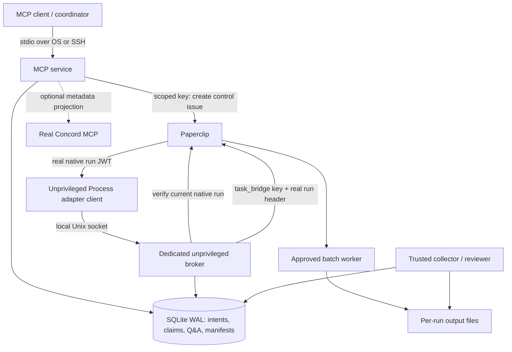

# Architecture and decisions

## Authority

Paperclip owns task assignment, its run lifecycle and global task status.
The journal owns local delivery intents, local scopes, messages, verified
snapshots and review attestations. Inspection returns both views. It does not
change remote state to force agreement with a local expectation.

We do not fork either upstream, invent `/api/v1/tasks` endpoints or claim that
our similarly named tools implement Concord's schemas. `concord.py` talks to
the actual upstream MCP server; native bridge tools use a `paperclip_` prefix.

## Why a native coordinator and Unix broker?

A persistent service key avoids dependence on browser sessions. In the tested
Paperclip version, scoped keys can create issues but mutations require a real
heartbeat run for attribution and cross-issue influence limits. Fabricating a
run or giving the bridge an administrator key would defeat that design.

The dedicated coordinator is a **non-model Process agent**. A control issue wakes
it; the platform supplies a run-scoped JWT. Its tiny client forwards that JWT
and run ID over a local socket. The broker checks that the run belongs to the
configured coordinator, is running and names a control issue assigned to it.
Only then does it drain validated intents. Remote writes use the narrower
persistent `task_bridge` key and the verified run header, not the broad native
JWT. The JWT is used only to authenticate/read the caller's own native run.

The broker runs as a separate OS user. It exposes no TCP port, shell executor,
arbitrary-file API or caller-selected operation. `NoNewPrivileges` stays enabled.

## Failure guarantees

SQLite uses WAL, `synchronous=FULL` and `BEGIN IMMEDIATE`. Operations commit
their intent and a state transition before network writes. The transaction is
not held during the remote call.

Submission is idempotent for one principal/key/payload. The same key with a
different payload is rejected. A lost create response changes state to
`create_uncertain`; startup quarantines a crashed `creating` state. Neither
is automatically replayed. An operator can adopt a known issue only after
checking its task marker, backlog status and lack of assignment.

This is **not distributed exactly-once delivery**. The crash-before-send window
may need operator reconciliation even when no remote task exists. A lost control
issue response likewise remains uncertain. Safety takes priority over automatic
replay. Remote PATCH/close behavior still depends on the installed Paperclip API.

Dispatch reservations persist until an explicit terminal-run and environment
cleanup observation. Time alone does not free a worker slot. Those reservations
cover this bridge; Paperclip remains responsible for concurrency with other
operators. Native readiness probes are time-bounded observations, not leases on
the external scheduler.

## Batch communication

Messages are addressed to durable tasks and fixed process principals. A message
is `recorded`; a linked reply makes the original `replied`. There are no invented
"model read" receipts. Worker views contain only messages sent or received by
that principal. The coordinator mediates requests between workers.

A continuation requires a terminal execution, a verified snapshot and a linked
question/answer. Verified UTF-8 files are embedded in the new bounded task
description, so a separate host path is never mistaken for transferred context.
Oversize or binary input is rejected rather than silently truncated.

Children are permitted only while a parent is parked at `review_ready`.
Their scopes must be contained in the parent; sibling overlaps are rejected.
Depth and child counts are bounded. A parent cannot be accepted while a child
is unfinished. Automatic parallel merge and arbitrary worker delegation are
outside v0.1.

## Artifact and review boundary

The operator collects explicitly named files from an exact run directory.
Directory file descriptors and `O_NOFOLLOW` prevent symlink traversal; special
files, hard links, changing files and size overruns are rejected. Bytes are
snapshotted with SHA-256, so subsequent retrieval does not reread mutable paths.

The digest covers the canonical manifest **including content**. A returned
metadata-only manifest is a view; its own serialized bytes do not reproduce
that digest. Ask for content or use the full stored record to verify it.

Review records what the operator reports having tested against that digest.
It does not execute arbitrary model-selected test commands. Native interaction
acceptance is not automated, because it can requeue work in the tested server.
The final task status is patched and read back only after checking execution
locks. No claim of integration/deployment is inferred from task completion.
