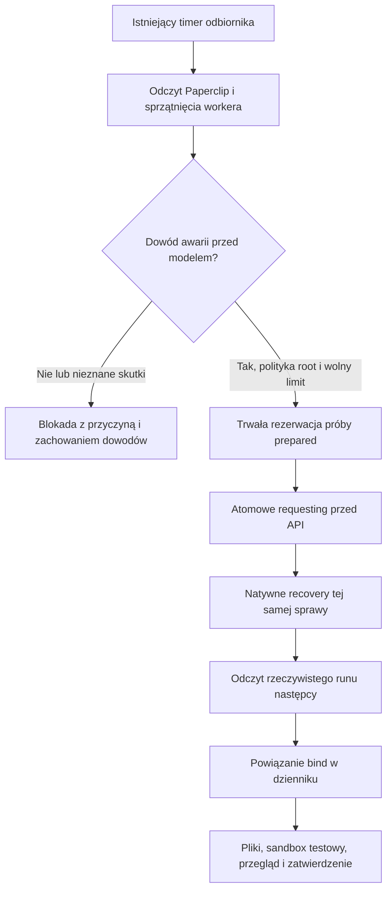

# Automatyczne recovery współpracy Codex–Antigravity

Wydanie 0.4.0 rozwija most ConcordMCPforPaperclip o ograniczone ponowienie
tej samej pracy po udowodnionej awarii przed uruchomieniem modelu. Paperclip
nadal uruchamia i rozlicza wykonawców. Recovery jest częścią istniejącego
cyklu odbiornika; nie dodaje drugiego schedulera ani autonomicznego modelu.

## Po co

Wcześniej zatrzymanie hosta, błąd transportu lub nieudany handoff wymagały
od supervisora odczytu runów, sprawdzania środowiska i ręcznego powiązania
kolejnej próby. Nowy kod automatyzuje część, dla której można niezależnie
udowodnić brak wykonania. Odbiera także wyniki po restarcie i odnajduje
rzeczywisty run następcy po utracie odpowiedzi API.

Nie każdy błąd jest bezpiecznym powodem ponowienia. Gdy model mógł już wykonać
pracę, timeout, brak plików albo status `error` nie stanowią dowodu braku skutków.
Takie przypadki pozostają zablokowane z kodem przyczyny. Recovery nie odnawia
poświadczeń, nie obchodzi pauzy ani limitów dostawcy i nie zmienia profilu.

## Jak działa

Polityka administratora przypina firmę, projekt, repozytoria, wykonawcę,
identyfikator polityki i budżet. Pilot dopuszcza jedną próbę recovery na zadanie;
biblioteka przyjmuje od zera do dwóch. Dowody mogą mieć najwyżej 60 sekund.
Treść zadania i komunikat modelu nie mogą zmieniać tej konfiguracji.

Dowód przed wykonaniem obejmuje jednocześnie:

- natywny zakończony run, właściwą sprawę i wykonawcę;
- zaufany adapter Process z przypiętym poleceniem, argumentami i SHA-256;
- exit 75 i dokładny, ograniczony komunikat `concord.pre_provider_failure.v1`;
- brak Job/pod oraz brak katalogu workspace tego runu;
- brak innego aktywnego runu, blokad checkout, pauzy, błędu auth/quota/security;
- zgodną natywną akcję recovery, wolny slot i zachowane claims.

Sam JSON z identyfikatorami nie jest poświadczeniem. Pochodzi z natywnego
wyniku zweryfikowanego adaptera, odczytanego przez uprzywilejowaną bramę.
Komunikat zawiera dokładnie `kind`, `task_id`, `issue_id`, `agent_id`,
`company_id`, `project_id`, `run_id`, `producer_sha256`, `error_kind`.
Duplikaty kluczy i dopisane pola nie uprawniają do ponowienia.
Adapter musi ustawić granicę rozpoczęcia providera **przed** przekazaniem pracy
workerowi; po tej granicy nigdy nie wystawia dowodu `not_performed`.

## Trwałość i brak podwójnego wykonania

SQLite pozostaje w wersji schematu 1; dodano tabelę `recovery_intents`.
Transakcje `BEGIN IMMEDIATE`, WAL/FULL, unikalny zamiar dla źródłowej próby
i istniejący indeks slotu chronią przed równoległymi ponowieniami.
Źródłowy nieudany run i jego evidence pozostają bez zmian. Claims nie są
zwalniane podczas recovery.

Restart po `prepared`, przed `requesting`, jest bezpieczny: nie przejęto jeszcze
prawa do wywołania API. Nowy cykl ponownie sprawdza świeże dowody i politykę,
uwzględnia własną rezerwację budżetu i atomowo przejmuje zamiar.

`requesting`, `waiting` i `uncertain` nigdy nie wysyłają tego samego resolve
ponownie. Po utracie odpowiedzi kolejny cykl jedynie odczytuje Paperclip.
Powiązanie wymaga zgodności źródłowego runu, natywnej akcji, sprawy, wykonawcy
i zakresu. Odpowiedź HTTP sama nie jest dowodem uruchomienia. Osobny trwały
rejestr efektów w bramie root dodatkowo blokuje drugie wywołanie.

Jeśli proces padnie po zapisaniu `requesting`, lecz przed samym API, a Paperclip
nie ma następcy, nie można rozstrzygnąć skutku na podstawie dziennika. Taki
zamiar pozostaje niepewny. To świadoma granica automatyzacji bez natywnego
idempotency key, a nie obietnica naprawiania każdego rodzaju awarii.

Czas `attempt_dispatched` pochodzi sprzed wywołania API. Osobno zachowujemy
czas odbioru/powiązania. Dzięki temu telemetria nie odrzuca następcy, który
wystartował wcześniej niż lokalny `bind`.

## Granice uprawnień i wdrożenie

`recovery_policy.py` i `recovery_evidence.py` są czystymi modułami Antigravity.
`recovery_state.py` i `recovery_driver.py` pochodzą od Codex. Supervisor
przejrzał artefakty, poprawił integrację i dodał niezależne regresje.
`recovery_service.py` łączy je z odbiornikiem, `recovery_host.py` z bramą.
`scripts/native-recovery-backend.mjs` to stała zdolność root dla zgodnego
wariantu Paperclip, a nie serwer HTTP lub narzędzie modelu.

Włączenie wymaga konfiguracji root i zgodnego adaptera producenta dowodów.
`recovery-cycle` wykonuje odbiór, ograniczone recovery i istniejące reguły
akceptacji. `recovery-context` jest odczytem SQLite bez ładowania tokenu i bez
zapisu. Brama przyjmuje wyłącznie identyfikatory zadania i zamiaru; sama
odczytuje dowody. Nie przyjmuje od modelu poleceń, ścieżek ani flag bezpieczeństwa.

Pomocnik root korzysta z krótkiego lease właściciela i odwołuje go w `finally`.
Odtwarza jedynie wskazaną akcję recovery. Może wyczyścić stan błędu profilu
wyłącznie po sprawdzeniu, że jego najnowszym runem jest dokładnie potwierdzona
awaria przed modelem. Nie ma ogólnego resetowania profili, auth ani uprawnień.
Trwały zapis przed mutacją blokuje ponowne wywołanie po niepewnym wyniku.

Odbiornik może dodatkowo wybudzić **niemodelowy** koordynator dla dozwolonego
backlogu po świeżym potwierdzeniu gotowości. Limit wynosi dwa trwałe wybudzenia
na zadanie; niepewnego utworzenia kontrolki nie ponawia. Model nadal startuje
wyłącznie przez Paperclip.

Wrapper Codex zatrzymuje token API w procesie handoffu i usuwa go z otoczenia
CLI modelu przy pracy mostu. Zapobiega to zwykłemu przedwczesnemu `Done` przez
klienta modelu. Nie stanowi izolacji przed złośliwym procesem tego samego UID.
Odrzucony handoff można formalnie uzgodnić przez `reconcile-cancelled` dopiero
po natywnym anulowaniu i dowodzie zakończenia. Funkcja nie udaje sukcesu,
nie jest narzędziem MCP i nie anuluje zdalnej pracy.

Firmowy adapter, konfiguracje, adresy, identyfikatory wdrożenia i surowe dowody
pozostają w wykluczonym `site-private/recovery-auto/`. Publiczne źródła i paczki
nie zawierają tych materiałów. Wdrożenie wymaga osobnego, chronionego backupu
konfiguracji i sekretów; publiczny bundle Git go nie zastępuje.

## Test odbiorczy

Odbiór przeprowadzono 24/25 października 2026 na rzeczywistym Paperclip.
Antigravity Adam dostarczył politykę, decoder dowodów i nowy moduł raportowania;
Codex dostarczył dziennik oraz kontroler. Konfiguracja i entrypoint workera
wskazują `gemini-3.8-flash-high`; telemetria użycia Codex wskazuje `gpt-6.1-sol`.
Nie uzyskano osobnej atestacji tożsamości modeli od dostawców.

| Etap | Sprawdzony wynik |
|---|---|
| Przygotowanie kodu | Trzy partie z rzeczywistymi plikami, testami i formalnym Done/complete. Pierwszy nieudany handoff Codex zachowany jako odrzucony/anulowany; poprawiona partia odebrana osobno. |
| Rozruch | Wykryto brak absolutnej ścieżki polecenia w minimalnym PATH. Naprawiono konfigurację; odbiornik sam wybudził koordynator dla tej samej kolejki. Nie utworzono drugiego zadania wykonawcy. |
| Kontrolowana awaria | Pierwszy run exit75 przed providerem. Zaufany komunikat, brak workspace i brak Job/pod potwierdzone. |
| Restart odbiornika | Proces zakończono testowo kodem77 po trwałym `prepared`, przed `requesting`. Istniejący timer uruchomił kolejny cykl; rezerwacja została przejęta bez drugiej próby. |
| Utrata odpowiedzi | Natywne resolve zostało przyjęte; brama celowo przerwała odpowiedź. Dziennik zapisał `uncertain`; kolejny cykl sam odnalazł właściwego następcę i wykonał `bind`. |
| Rzeczywiste wykonanie | Jedna sprawa, dwa natywne runy: pierwszy failed/75, drugi succeeded/0. Jeden resolve. Model pracował dopiero w drugim runie. |
| Pliki i testy | Trzy oczekiwane pliki. SHA256 zgodne na workerze, w odebranym MCP snapshot i w przeglądanym manifeście. Worker success/exit0/denied_actions=[]; niezależny K3s verifier bez poświadczeń i z deny-all PASS. |
| Przegląd | Nowy kod raportowania przejrzano; 36 testów wykonawcy PASS także lokalnie, dodatkowo 11111 wyczerpujących historii wobec niezależnego wzorca. Karta natywnego wyniku accepted, sprawa Done, most complete, claims0. |
| Stan końcowy | Cztery zaakceptowane partie Done/complete i claims0; źródłowe nieudane próby zachowane. Wstrzykiwanie awarii, crash i utrata odpowiedzi wyłączone. Właściwe recovery pozostaje włączone z limitem1 dla zatwierdzonego zakresu. |

Od kontrolowanego exit75 do odbioru plików nie wykonywano ręcznych zmian
journalu, profilu ani restartów usług. Test ujawnił wcześniej błąd konfiguracji
podczas rozruchu; tego przygotowania nie przedstawiamy jako samonaprawy.
Odbiór nie polegał na kopiowaniu gotowej próbki: wznowiony agent napisał nowy
`summarize_recovery`, jego walidację i testy.

Weryfikacja całego repozytorium: wyniki końcowe lokalne i CI są podane w
[TESTING](../TESTING.md). Testy obejmują także brak podwójnego resolve przy
równoległych kontrolerach, restart z prepared, realny schemat terminal/profile,
zachowanie claims, odrzucenie podrobionych i nieświeżych dowodów, brak zapisu
przez `recovery-context`, brak ponowienia niepewnego wake i limit backlogu.
Podsumowanie licznikowe jest funkcją raportową i nie nadaje uprawnień recovery.

Oryginalny Concord0.16.0 otrzymał kontekst integracji i wiadomość do jawnego
proxy Antigravity. Jest to projekcja nadzorcy; nie deklarujemy bezpośredniej
sesji komunikacyjnej między żywymi modelami. Wykonanie, recovery i review
udowodniono osobno w Paperclip i trwałym dzienniku.

## Co pozostaje ograniczeniem

Automatyczne ponowienie przed providerem jest wdrożone dla zaufanego adaptera
Process i jawnie zatwierdzonych publicznych repozytoriów. Nie rozszerzono go na
nieudowodnione błędy dowolnego wykonawcy Codex. Kanał Codex zachowuje wcześniejsze
recovery poprawnego wyniku i dyspozycji oraz poprawiony wrapper handoffu.
Nie testowano rzeczywistego wyczerpania quota, awarii systemu plików hosta ani
pełnego odtwarzania klastra. Niepewny efekt bez następcy wymaga rozstrzygnięcia
zewnętrznego; brak pliku nie uprawnia do ponownego uruchomienia modelu.

Nowy kod wymaga przeglądu koordynatora. Automatyczne akceptowanie dowolnego
programu nie zostało włączone. Zastosowanie firmowe i poufne wymaga osobnego
zakresu oraz ochrony danych. Publiczny kod można rozwijać na podstawie tego
pilota, ale nie jest to potwierdzenie pełnej autonomii produkcyjnej.
