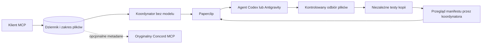

# Concord MCP for Paperclip

## Cel i wartość

Projekt łączy klienta MCP z wykonawcami uruchamianymi przez Paperclip. Rozwiązuje
praktyczny problem pracy agentów wsadowych: proces kończy się, ale zadanie,
pytania, odpowiedzi i przekazane pliki muszą przetrwać jego zakończenie.
Koordynator otrzymuje trwały zapis i może ocenić konkretny wynik zamiast polegać
na wiadomości „gotowe”. Ma to sens przy delegowaniu małych prac programistycznych
i powtarzalnej weryfikacji ich wyników. Nie ma jeszcze pomiaru oszczędności czasu
ani kosztów, a projekt pozostaje eksperymentalny.

## Podział odpowiedzialności

Paperclip jest źródłem prawdy o wykonaniu: wybiera skonfigurowany adapter,
uruchamia agenta i zapisuje rzeczywisty identyfikator uruchomienia. Most MCP
przyjmuje specyfikację, ogranicza zakres plików i zapisuje zamiar w SQLite WAL.
Natywny koordynator bez modelu obsługuje kolejkę przez lokalny socket Unix.
Nie przechowuje hasła człowieka w kontekście modelu. Stały klucz usługi ma
ograniczenia projektu i listę dozwolonych wykonawców.

Wynik obejmuje kopię konkretnych plików i manifest SHA256 związany z zadaniem,
agentem oraz uruchomieniem. Odbiornik sprawdza typy plików, rozmiary i zakres;
odrzuca dowiązania i wykryte typowe postacie sekretów. To dodatkowa kontrola,
nie gwarancja kompletnego wykrywania danych poufnych. Niezależny weryfikator
uruchamia kopię w osobnym środowisku bez poświadczeń wykonawcy. Zatwierdzenie
wiąże się z dokładnym skrótem manifestu i wynikami testów. Dopiero potwierdzone
zamknięcie w Paperclip zwalnia blokady zakresu plików.

Pytania są trwałymi wiadomościami. Odpowiedź może posłużyć do przygotowania
ograniczonej kontynuacji wraz ze sprawdzonymi plikami. Nie jest to rozmowa na żywo
z procesem, który już się zakończył. Inny agent nie uzyskuje przez wiadomość
uprawnień koordynatora.

## Odbiór i recovery natywnego Codex

Wersja 0.3.0 dodaje osobny odbiornik Codex, niezależny od bramy Antigravity.
Stały wrapper uruchamia właściwy CLI i po jego sukcesie przekazuje zadanie do
przeglądu, zachowując przypisanie wykonawcy. Timer odbiera wyłącznie już
zlecone prace. Sprawdza rzeczywisty run, brak procesów i blokad, kopiuje tylko
wskazane pliki i uruchamia niezależne testy ich niezmiennej kopii.

Odbiornik przypina pierwszy run i snapshot w trwałym dzienniku. Po restarcie
odczytuje ten sam wynik. Dodatkowy run wolno uznać za naprawę tylko wtedy,
gdy Paperclip potwierdza konkretną dyspozycję recovery, jej źródło i właściciela.
Wrapper naprawy nie uruchamia ponownie modelu: odtwarza formalne przekazanie do
przeglądu. Nieznana naprawa, nowe wykonanie kodu, odmowa uprawnień lub niepewny
zapis zatrzymują dany obieg do uzgodnienia zamiast powielać pracę.

Nowy kod nie zatwierdza dowolnego wyniku na podstawie deklaracji agenta.
Zwykły wynik oczekuje na przegląd koordynatora przez MCP. Dla powtarzalnych
prób syntetycznych można przed zleceniem włączyć zaufaną politykę obejmującą
klucz zlecenia, skrót jego specyfikacji i skróty wszystkich oczekiwanych plików.
Warunkiem automatycznej akceptacji pozostają niezależne testy i zgodny manifest.
Polityka jest domyślnie wyłączona i nie jest dostępna z narzędzi modelu.

Weryfikator używa osobnego poda K3s, przypiętego obrazu, użytkownika bez roota,
systemu plików tylko do odczytu, ograniczeń zasobów i czasu, braku tokenu ServiceAccount,
polityki deny-all oraz seccomp blokującego operacje sieciowe i io_uring.
Sam NetworkPolicy nie wystarczał do wykluczenia początkowego wyścigu sieci.
Ochrona jest warstwowa; przegląd kodu nadal jest potrzebny.

## Z czego projekt powstał

Punktem wyjścia była propozycja zastosowania
[Get-Concord-AI/concord-mcp](https://github.com/Get-Concord-AI/concord-mcp)
do koordynacji agentów. Sprawdzono oryginalny Concord 0.16.0, commit
`f00d7c812ff708979b1784c48b0201096bc8bad5`, przez jego faktyczny interfejs MCP.
Wcześniejsza koncepcja wygenerowana przez Gemini była materiałem do analizy,
a nie wdrożonym kodem: zawierała niezgodności z rzeczywistym API i założenia
wymagające poprawy. Nie uruchomiono jej generatora.

Powstał niezależny adapter w Pythonie, nie fork ani oficjalny produkt Concord.
Korzysta z oficjalnego Python MCP SDK 1.30.0, SQLite WAL/FULL i natywnego API
Paperclip. Natywny Process adapter Paperclip zapewnia tożsamość uruchomienia;
wykonawcy używają własnych adapterów. Oryginalny Concord jest opcjonalną projekcją
metadanych do wspólnego obszaru pracy. Nie zarządza uruchomieniami ani nie
zastępuje Paperclip. Kod upstream nie jest dołączony do naszej paczki.

Rozwój obejmował trwałą kolejkę i ograniczenia delegacji, rzeczywistą integrację
Concord, natywne uruchomienia i odbiór Antigravity, izolowany weryfikator,
a następnie poprawkę odświeżania polityki weryfikatora i kontrolowany handoff
już zainicjalizowanej sesji stdio. Etap 0.3.0 dodaje automatyczny odbiór Codex,
kontrolowane recovery i ograniczoną akceptację prób syntetycznych.

## Stan i granice zastosowania

[Odbiór automatyzacji 0.3.0](ODBIOR-AUTOMATYCZNY-CODEX.md) potwierdza dwie
świeże próby zakończone Done bez operatora, odrzucenie błędnych testów i restart
bez powielania zatwierdzeń. Naprawa dyspozycji nie uruchomiła ponownie modelu.
Akceptację końcową wykonuje jawnie skonfigurowana, ograniczona brama właściciela;
nie udaje ona natywnego agenta recenzenta.

Wersja publicznego kodu to 0.3.2; próba współpracy używała runtime Codex 0.3.1
i oddzielnego Process 0.2.1 z wąskimi poprawkami odbioru. Kontrola dostępu, niepewne zapisy,
ponowienia, zakresy plików i kontynuacje mają testy automatyczne. Po utracie
odpowiedzi na nieidempotentne utworzenie zadania system zatrzymuje niepewną
operację do uzgodnienia; nie uruchamia drugiego wykonawcy w ciemno.

Rozsądny następny etap to powtarzalny pilot na publicznych lub syntetycznych
zadaniach oraz pomiar czasu, kosztu i częstości poprawek. Przed rozszerzeniem
użycia warto dopracować politykę retencji, procedurę odtwarzania dziennika
i obsługę kolejnych rodzajów zadań. Nie ma podstaw, by na tym etapie deklarować
pełną autonomię produkcyjną, przetwarzanie danych poufnych lub automatyczne wdrażanie.

Szczegóły kontraktu: [API](../API.md), [bezpieczeństwo](../SECURITY.md),
[ograniczenia](../LIMITATIONS.md), [testy](../TESTING.md).

## Współpraca dwóch wykonawców

[Pełny odbiór Codex–Antigravity](WSPOLPRACA-CODEX-ANTIGRAVITY.md) potwierdza
dwa rzeczywiste pytania i odpowiedzi, wspólną implementację i testy: cztery
partie Done/complete, 51 testów i zero claims. Oryginalny Concord przechowuje
wiadomości pomiędzy jawnymi proxy nadzorcy; Paperclip wykonuje powiązane partie.
Po awarii zachowano istniejące zadania i historię, uzgodniono stan przez native
recovery i naprawiono wybór przebiegu oraz zbyt mały limit odpowiedzi HTTP
w adapterze. To nadzorowana współpraca bez ręcznych odpowiedzi i kliknięć,
a nie dowód ogólnego, samoczynnego odtwarzania infrastruktury.
